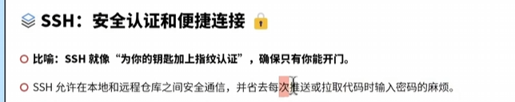
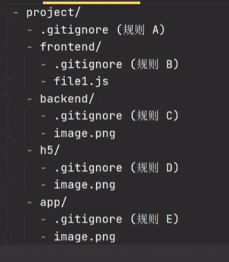

# 一些有用的知识

# git以及github的使用

Git常用命令以及SSH配置



git常用命令


## git使用时问题解决

1.上传到github时报错

原因：**开着代理/VPN，但 git 没走代理** 

浏览器能开 GitHub 是因为浏览器走了系统代理或插件代理，但 **git 默认不读系统代理**，需要自己配置

首先查看代理在本地的什么端口，如果梯子有的话就看梯子，或者

如果梯子开了"系统代理"模式，Windows 里会直接写明地址和端口：

**设置 → 网络和 Internet → 代理 → 手动设置代理**

找到代理地址和端口，然后终端运行

```powershell
git config --global http.proxy 代理地址:端口号
```

然后再push就ok了


# gitignore的使用

https://www.bilibili.com/video/BV1fp4y1u7aK/?spm_id_from=333.337.search-card.all.click&vd_source=83e86f01de6b9a88af5641a22bd8ad7b

语法


若多个文件夹中都含有.gitignore文件，那么子文件夹的.gitignore文件会覆盖掉父文件夹的规则，并且只会影响该子文件夹及其孙以后文件夹的文件，就是说当前文件夹的.gitignore文件的规则只会对当前文件夹以及其所有子目录生效




当已经把项目文件上传github后(未上传.gitignore文件)，如果此时再上传.gitignore文件，就会导致远程仓库中想要忽略的文件仍然存在，原因是：在原理上是因为


对于已经被git跟踪的文件，gitignore不会停止跟踪他们

解决办法就是手动告诉git停止跟踪这些已经被跟踪的文件，对应的命令如下：

`git rm -r --cached 文件名`

这条命令会从git的索引中把对应文件夹删除，告诉git不用再跟踪了，同时不会删除本地文件

接着再commit然后push就能在远程仓库中正常删掉这些文件了


# 读论文思路

